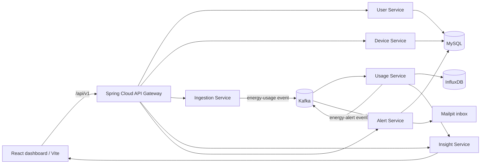

# Home Energy Tracker — Professor Demo Guide

Use this as the live-demo runbook and speaking script. It is written for Windows PowerShell because that is the current development machine.

> **Demo rule:** start the backend first, wait for the API Gateway to become ready, then open/refresh the frontend. If Vite starts before the Gateway, its terminal prints `ECONNREFUSED`; that only means port `8080` was not ready yet.

---

## 1. What you are demonstrating

**One-line introduction**

> “Home Energy Tracker is an event-driven microservices platform that accepts appliance energy readings, publishes them through Kafka, stores time-series usage in InfluxDB, calculates cost and forecast insights, and warns the household when usage crosses its threshold.”

### What makes it different

The project does not only display total electricity usage. Its main novelty is the **Standby Energy Detective**:

- estimates continuous idle or phantom load during low-activity periods;
- converts that load into monthly wasted kWh and estimated cost;
- classifies risk as `LOW`, `MEDIUM`, or `HIGH`;
- gives practical actions such as sleep timers, smart power strips, and unplugging idle devices.

Pair it with the **Bill Shock Forecast**: “If current usage continues, what might the month-end bill look like?”

---

## 2. Architecture you can show and explain



### Say this while showing the diagram

> “The frontend never calls every service directly. It calls the API Gateway. The Gateway routes each request to the correct microservice. MySQL stores relational data such as users, devices, and alerts, while InfluxDB stores timestamped energy readings. Kafka makes ingestion asynchronous: a meter event can be accepted quickly even if calculations or notification delivery take longer.”

| Component | Why it exists |
| --- | --- |
| API Gateway | One entry point, routing, correlation IDs, and a clean frontend API boundary |
| Kafka | Decouples ingestion from downstream usage processing and alerting |
| InfluxDB | Optimized for timestamped energy observations and range queries |
| MySQL | Stores users, devices, thresholds, and alert history reliably |
| Insight Service | Bill forecast, device ranking, standby-load analysis, saving tips |
| Mailpit | Safe local email inbox for demonstrating alerts without sending real emails |

---

## 3. Before the professor arrives — 10-minute setup

Do this **before** the demo, not while explaining. A cold Spring Boot/Docker startup can take 2–4 minutes.

### Step 3.1 — Start Docker Desktop

Open Docker Desktop and wait until it says **Engine running**.

Verify from the project root:

```powershell
docker version
```

**Expected:** both `Client` and `Server` versions appear. If `Server` is blank or a Docker pipe connection error appears, Docker Desktop is not ready.

### Step 3.2 — Open the project root

```powershell
Set-Location 'C:\Users\anju2\Desktop\Home-Energy-Tracker'
```

### Step 3.3 — Create local environment file once

Run this only if `.env` does not already exist:

```powershell
if (-not (Test-Path .env)) {
  Copy-Item .env.example .env
}
```

Do **not** display `.env` to the professor; it contains local credentials/tokens.

### Step 3.4 — Start backend containers

For a development demo, Vite owns port `3000`. Therefore start all backend services **except** the Docker `frontend` service:

```powershell
$backendServices = @(
  'mysql', 'kafka', 'kafka-ui', 'influxdb', 'mailpit', 'keycloak',
  'user-service', 'device-service', 'ingestion-service',
  'usage-service', 'alert-service', 'insight-service', 'api-gateway'
)

docker compose up -d --build $backendServices
```

**Expected:** Docker prints `Started` or `Running` for the listed services. The first run downloads/builds images and takes longer.

### Step 3.5 — Wait for the Gateway, not just Docker containers

```powershell
docker compose logs --tail=50 api-gateway
```

Continue only after you see a line similar to:

```text
Netty started on port 8080 (http)
Started ApiGatewayApplication
```

Then verify it:

```powershell
(Invoke-WebRequest -UseBasicParsing 'http://localhost:8080/actuator/health').StatusCode
```

**Expected:** `200`.

### Step 3.6 — Start the frontend

Open a **second** PowerShell terminal:

```powershell
Set-Location 'C:\Users\anju2\Desktop\Home-Energy-Tracker\frontend'
npm run dev
```

**Expected:**

```text
VITE ... ready
Local: http://localhost:3000/
```

Open [http://localhost:3000](http://localhost:3000) and do a hard refresh with `Ctrl+Shift+R`.

### Step 3.7 — Obtain short-lived local demo tokens

The default local configuration enables Gateway security. Run this PowerShell
block in the terminal used for API proof commands. The accounts are imported
development-only Keycloak users; do not use them outside the local Compose
stack.

~~~powershell
function New-LocalApiHeaders {
  param(
    [Parameter(Mandatory)] [string] $Username,
    [Parameter(Mandatory)] [string] $Password
  )

  $token = Invoke-RestMethod -Method POST -Uri 'http://localhost:8180/realms/home-energy/protocol/openid-connect/token' -ContentType 'application/x-www-form-urlencoded' -Body @{
    grant_type = 'password'
    client_id = 'home-energy-cli'
    username = $Username
    password = $Password
  }

  @{
    Authorization = "Bearer $($token.access_token)"
    'X-Correlation-ID' = "professor-demo-$([guid]::NewGuid().ToString())"
  }
}

$userHeaders = New-LocalApiHeaders -Username 'demo-user' -Password 'DemoUser-ChangeMe-2026!'
$adminHeaders = New-LocalApiHeaders -Username 'demo-admin' -Password 'DemoAdmin-ChangeMe-2026!'
~~~

The development access token lifetime is short. If a command returns 401,
rerun this block. In the browser, sign in through Keycloak using demo-user or
demo-admin; the frontend keeps its session refreshed during normal use.

### Step 3.8 — Prove the Vite proxy is healthy

From another terminal:

```powershell
Invoke-RestMethod 'http://localhost:3000/api/v1/user/1' -Headers $userHeaders |
  Format-Table id, name, email, energyAlertingThreshold
```

**Expected:** the household assigned to demo-user appears. This proves the actual chain is:

```text
Browser / Vite (:3000) → API Gateway (:8080) → User Service (:8081) → MySQL
```

---

## 4. Live demo sequence — 7 minutes

### Minute 0:00–0:45 — Opening

Say:

> “Sir, a normal energy dashboard only shows consumption after the fact. This project makes it event-driven: readings enter immediately, analysis happens asynchronously, and the system highlights both expensive appliances and hidden standby waste.”

Show the dashboard at [http://localhost:3000](http://localhost:3000).

Point out:

- household selector and threshold;
- total kWh and estimated cost;
- month-end Bill Shock Forecast;
- appliance ranking;
- Standby Energy Detective panel.

### Minute 0:45–1:30 — Prove it is not only a frontend screen

In PowerShell:

```powershell
Invoke-RestMethod 'http://localhost:8080/api/v1/user' -Headers $adminHeaders |
  Format-Table id, name, email, energyAlertingThreshold

Invoke-RestMethod 'http://localhost:8080/api/v1/device/user/1' -Headers $userHeaders |
  Format-Table id, name, type, location, userId
```

Say:

> “This is the same data exposed through the Gateway. Users and device metadata live in MySQL, while the energy measurements are intentionally handled separately as time-series data.”

### Minute 1:30–2:30 — Inject one real event

This uses an existing demo device. The API expects **kWh**, not watts.

```powershell
$reading = @{
  deviceId = 1
  energyConsumed = 0.25
  timestamp = (Get-Date).ToUniversalTime().ToString('o')
} | ConvertTo-Json -Compress

$response = Invoke-WebRequest -UseBasicParsing `
  -Method POST `
  -Uri 'http://localhost:8080/api/v1/ingestion' `
  -Headers $userHeaders `
  -ContentType 'application/json' `
  -Body $reading

$response.StatusCode
```

**Expected:** `201`.

Say:

> “The Ingestion Service validates this reading and publishes an `energy-usage` event to Kafka. It does not wait for reporting, forecasting, or email delivery.”

> If your physical/simulated meter reports watts, convert it before posting: `kWh = watts × hours / 1000`. Do not label a watts value as `energyConsumed`, otherwise the analytics become physically incorrect.

### Minute 2:30–3:20 — Show the event pipeline

Wait 10–20 seconds so the consumer and scheduled aggregation can finish:

```powershell
Start-Sleep -Seconds 15

Invoke-RestMethod 'http://localhost:8080/api/v1/usage/1?days=3' -Headers $userHeaders |
  ConvertTo-Json -Depth 5
```

Optional visual proof:

- Kafka messages: [http://localhost:8070](http://localhost:8070) → topics → `energy-usage`.
- InfluxDB: [http://localhost:8072](http://localhost:8072) → bucket `usage-bucket`.

Say:

> “Kafka consumer processing writes the measurement to InfluxDB. This lets the system query by time range and device without putting high-frequency readings into the relational database.”

### Minute 3:20–4:30 — Show the intelligence

```powershell
Invoke-RestMethod 'http://localhost:8080/api/v1/insight/bill-forecast/1?days=3' -Headers $userHeaders |
  ConvertTo-Json -Depth 4

Invoke-RestMethod 'http://localhost:8080/api/v1/insight/appliance-ranking/1?days=3' -Headers $userHeaders |
  ConvertTo-Json -Depth 5

Invoke-RestMethod 'http://localhost:8080/api/v1/insight/standby-detective/1?days=3' -Headers $userHeaders |
  ConvertTo-Json -Depth 5
```

Say:

> “The Bill Shock Forecast extrapolates the observed daily rate through the configured tariff slabs. Appliance ranking identifies which device dominates usage. The Standby Energy Detective estimates continuous low-activity load, translates it into monthly cost, and returns a checklist the user can act on.”

### Minute 4:30–5:15 — Alert path

The seeded user threshold is shown by the user API. When aggregate consumption exceeds it, the Usage Service publishes `energy-alerts`; Alert Service saves the event and sends an email to Mailpit.

```powershell
Invoke-RestMethod 'http://localhost:8080/api/v1/alert/user/1' -Headers $userHeaders |
  Select-Object id, message, threshold, energyConsumed, email, createdAt |
  Format-Table -AutoSize
```

Open [http://localhost:8025](http://localhost:8025) to show the captured local email.

> **Do not repeatedly inject very large readings for a demo.** The current threshold job runs every 10 seconds and can generate repeated alerts while the preceding one-hour total remains above the threshold.

### Minute 5:15–6:15 — Explain resilience and honest limits

Say:

> “The savings-tip endpoint attempts an optional local Ollama AI model, but the numerical forecast and standby results are deterministic. If AI is unavailable, the application falls back safely rather than failing the dashboard.”

Also say this accurately if asked:

- The project currently uses simulated/manual meter events, not a connected physical smart meter.
- The 7-day line chart in the current frontend is illustrative client-side chart data; the forecast, ranking, standby, devices, alerts, and usage endpoints are the live-backed proof points.
- The production Compose and Azure deployment plan are prepared, but a cloud deployment/TLS certificate should not be claimed as already live unless it has actually been provisioned.

### Minute 6:15–7:00 — Close

> “So the outcome is not just a dashboard: it is a scalable pipeline from a reading event to time-series storage, analytics, forecasting, standby-waste detection, and threshold notifications. Each concern can scale independently because Kafka and the Gateway decouple the services.”

---

## 5. Likely viva questions and strong answers

| Professor may ask | Answer |
| --- | --- |
| Why microservices instead of one Spring Boot app? | Each concern has a separate scaling and failure boundary. Ingestion can absorb bursts, insight logic can evolve independently, and the Gateway prevents the frontend from depending on internal topology. |
| Why Kafka? | It turns reading ingestion into an asynchronous event. The client gets a quick acknowledgement while Usage and Alert services consume the event independently. |
| Why MySQL and InfluxDB together? | MySQL is for relational records and constraints: users, devices, thresholds, alert history. InfluxDB is for high-volume timestamped energy observations and time-window aggregation. |
| What is the novelty? | Standby Energy Detective converts an estimated continuous idle load into a monthly money impact and actionable saving steps, alongside a Bill Shock Forecast. |
| Is standby detection exact appliance-level disaggregation? | No. It is a transparent heuristic based on low-activity baseline assumptions. A future version can use meter-level signatures or ML disaggregation for finer attribution. |
| Is AI required for the app to work? | No. Cost calculations, ranking, forecast, and standby analysis are deterministic. AI is an optional enhancement for natural-language tips with a safe fallback. |
| How do you test it? | Frontend production build/lint, service unit/application-context tests, API health checks, and an end-to-end event path: POST reading → Kafka → InfluxDB → insight/alert endpoint. |
| How would you host it? | Package services as Docker images, run production Compose on an Azure Linux VM, store secrets outside source control, and put TLS/reverse-proxy configuration in front. This is the planned deployment path; I would only call it deployed after provisioning and verification. |

---

## 6. Fast troubleshooting — use this, not guesswork

### `ECONNREFUSED` or Vite proxy errors for `/api/v1/...`

Meaning: Vite is running, but `localhost:8080` is unavailable or still booting.

```powershell
Set-Location 'C:\Users\anju2\Desktop\Home-Energy-Tracker'
docker compose up -d mysql kafka kafka-ui influxdb mailpit user-service device-service ingestion-service usage-service alert-service insight-service api-gateway
docker compose logs --tail=50 api-gateway
```

Wait for `Netty started on port 8080`, then hard-refresh the browser with `Ctrl+Shift+R`.

### `docker version` has no Server version

Docker Desktop is not ready. Open it and wait for **Engine running**. Do not start the frontend first and expect the proxy to create backend services.

### Port `3000` is already in use

Choose one frontend mode:

1. **Development mode (recommended for demo):** run `npm run dev`; do not start the Docker `frontend` service.
2. **Container mode:** press `Ctrl+C` in the Vite terminal, then run `docker compose up -d --build frontend`.

Never run both on port `3000` at the same time.

### Gateway is up but an API returns `502`/`500`

The downstream service may still be booting. Check it directly:

```powershell
docker compose logs --tail=80 user-service device-service usage-service insight-service
```

Spring Boot services can take a few minutes on a cold machine. Wait for each `Started ...Application` log before refreshing the dashboard.

### Clean reset — only if you explicitly want to delete local demo data

> This removes MySQL, Kafka, and InfluxDB local volumes. Do not run it during a demo and do not run it if you need the existing data.

```powershell
docker compose down -v
docker compose up -d --build
```

---

## 7. What success looks like before you present

- Docker `Server` version exists.
- `http://localhost:8080/actuator/health` returns `200`.
- An authenticated request to `http://localhost:3000/api/v1/user/1` returns
  the assigned household through the Vite proxy.
- The dashboard opens with real API responses after a hard refresh.
- A POST to `/api/v1/ingestion` returns `201`.
- `/api/v1/usage/1`, forecast, ranking, and standby endpoints return JSON.
- Kafka UI, InfluxDB, and Mailpit pages open locally.

If all seven checks pass, the professor demo is ready.
