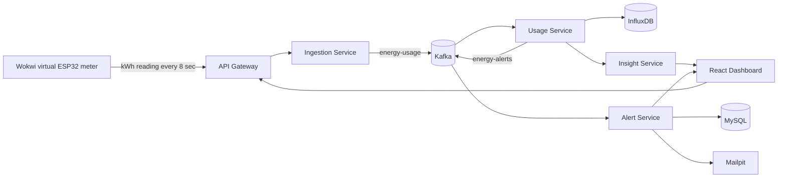

# Home Energy Tracker — Professor Live Demo Script

Use this as the **9–11 minute live presentation plan**. It shows two honest,
connected flows: an administrator creates an application household profile and
device; then the pre-provisioned Wokwi ESP32 meter sends a live reading for
the seeded demonstration household. The reading is processed through Kafka
and InfluxDB, converted into insights, and can generate an alert.

> Security distinction: creating an application profile is an administrator
> action. It does not create a Keycloak identity and it does not automatically
> provision an IoT device credential. The Wokwi end-to-end proof therefore
> uses the already provisioned `demo-user` / device `1` pair.

> The core local path in this script was exercised on 2026-10-11. Exact live
> HTTP statuses, aggregation values, alert evidence, and limitations are in
> [docker_live_runtime_validation_20261011.md](../evidence/15_final_validation/docker_live_runtime_validation_20261011.md).

This is a live-demo script, not a claim that the ESP32 is measuring a real mains circuit. Wokwi is a **virtual smart-meter test harness**: it proves the firmware, HTTP contract, backend pipeline, and alert flow before calibrated physical meter hardware is added.

> Keep the detailed command-level checks in [10-complete-feature-verification-guide.md](10-complete-feature-verification-guide.md). This document is the version to rehearse and show to a professor.

## 1. One sentence to open with

> “Home Energy Tracker is an event-driven household-energy system: a smart-meter reading is accepted through an API Gateway, carried asynchronously through Kafka, stored as time-series data, converted into forecast and standby-waste insights, and used to trigger an alert when the household crosses its limit.”

## 2. What the professor will see

By the end of the demo, you will have shown evidence for each of these claims:

| Claim | Live proof |
| --- | --- |
| An administrator can create a household application profile | **Add New Account** returns `201`; temporary CRUD can be removed after the demo |
| A household owner sees only assigned data | USER profile/usage/device requests return `200`, while a cross-household request returns `403` |
| The virtual meter is associated with an appliance | The pre-provisioned Wokwi configuration uses secured backend device `1` |
| A device can send telemetry | Wokwi OLED and terminal show `API: 201` with a kWh JSON payload |
| The reading is event-driven | Kafka UI shows the `energy-usage` topic; the Usage Service writes time-series data |
| Data becomes useful to the household | Dashboard shows forecast, ranking, and Standby Energy Detective |
| Thresholds create a real outcome | Alert History and Mailpit show the persisted/email alert |

## 3. Architecture to show or describe



Say this while the diagram is visible:

> “The dashboard has one public entry point: the API Gateway. User, device, and alert records are relational, so they use MySQL. Meter readings are timestamped and high-frequency, so they use InfluxDB. Kafka separates fast ingestion from downstream processing: the meter gets an acknowledgement quickly while analytics and alerts run independently.”

## 4. Before the professor arrives — do this privately

Do not spend presentation time waiting for Docker, a frontend server, or PlatformIO compilation.

### 4.1 Start and verify the application

Keep the project backend, frontend, and Wokwi simulator ready. From the
project root, obtain short-lived local headers without displaying credentials:

```powershell
Set-Location 'C:\Users\anju2\Desktop\Home-Energy-Tracker'

$realm = Get-Content -Raw 'docker\keycloak\home-energy-realm.json' | ConvertFrom-Json

function New-DemoHeaders([string]$username) {
  $account = @($realm.users | Where-Object { $_.username -eq $username }) |
    Select-Object -First 1
  $password = @($account.credentials | Where-Object { $_.type -eq 'password' }) |
    Select-Object -First 1
  $token = Invoke-RestMethod -Method POST `
    -Uri 'http://localhost:8180/realms/home-energy/protocol/openid-connect/token' `
    -ContentType 'application/x-www-form-urlencoded' `
    -Body @{ grant_type='password'; client_id='home-energy-cli'; username=$username; password=$password.value }
  @{ Authorization = "Bearer $($token.access_token)" }
}

$userHeaders = New-DemoHeaders 'demo-user'
$adminHeaders = New-DemoHeaders 'demo-admin'

(Invoke-WebRequest -UseBasicParsing 'http://localhost:8080/actuator/health').StatusCode
Invoke-RestMethod 'http://localhost:3000/api/v1/user/1' -Headers $userHeaders |
  Format-Table id, name, email, energyAlertingThreshold
```

Expected:

- the first command prints `200` — the API Gateway is ready;
- the second prints the demo user's assigned household — the frontend proxy,
  gateway, JWT, ownership check, User Service, and MySQL path are working.

The development access tokens are short lived. If a protected command returns
`401`, rerun this block before continuing.

If services are stopped, use the startup sequence in [09-professor-demo-guide.md](09-professor-demo-guide.md), section 3, **before** the presentation.

### 4.2 Keep these windows ready

| Window | Keep it ready for | Do not show until |
| --- | --- | --- |
| Browser tab 1: `http://localhost:3000` | Profile, device, dashboard, alert history | Opening |
| VS Code: `iot-simulator` | Wokwi circuit, OLED, terminal | Virtual meter section |
| Browser tab 2: `http://localhost:8070` | Kafka `energy-usage` evidence | Event pipeline section |
| Browser tab 3: `http://localhost:8025` | Safe local email proof | Alert section |
| Small PowerShell window | Refresh short-lived demo headers or show a protected Usage response | API fallback section |

Keep the Wokwi simulator **stopped** until its turn. This prevents many readings/alerts appearing before you explain them.

### 4.3 Verify the Wokwi route once

For the current VS Code Wokwi setup, the local route is:

```text
ESP32 → http://host.wokwi.internal:8080/api/v1/ingestion → API Gateway
```

In `iot-simulator/include/config.h`, do not change the URL if it already uses that route. The important value for this presentation is `DEVICE_ID`.

> This VS Code flow is local. Do not mention the older Cloudflare-tunnel approach during this demo; it is not needed here.

## 5. Choose the secure demo scenario

Use the two flows below rather than claiming that a newly created profile is
automatically paired with the simulated meter.

| Field | Recommended demo value |
| --- | --- |
| Administrator-created application profile | `Professor Demo Home` |
| Email | `professor.demo.20260926@example.com` |
| Energy threshold | `25` kWh |
| Appliance name | `Virtual Smart Meter` |
| Appliance type | `General Plug` |
| Location | `Demo Desk` |

First sign in as `demo-admin` to show the UI profile/device creation path. Call
it **application-profile provisioning**, not account-signup or Keycloak
identity creation. After showing it, delete the temporary record or leave the
administrator session.

For the Wokwi, Kafka, and alert path, sign in as `demo-user` and use the seeded
device `1`. Its device-specific ingestion credential is already injected into
the local Compose stack. Do not display that credential. Pairing a newly
created device requires adding a new device-token mapping and restarting the
appropriate service; it is intentionally not an automatic UI action in this
prototype.

The `25 kWh` threshold is deliberate: Wokwi's **Alert Test** mode produces
about 26–40 kWh, so it can visibly trigger the alert flow for an appropriately
pre-provisioned demo household.

## 6. Minute-by-minute presenter notes

Do not read every line word-for-word. Use the short quoted notes as your natural speaking points.

### 0:00–0:45 — Problem and outcome

**Show:** Dashboard at `http://localhost:3000`, signed in as `demo-user`.

**Say:**

> “Most electricity apps report usage after the fact. My project makes the process proactive: it accepts readings as events, forecasts likely cost, highlights major consumers and standby waste, and notifies the household when consumption crosses its own limit.”

Point at the household selector, forecast, appliance ranking, Standby Energy Detective, and alert limit.

### 0:45–1:25 — Explain the architecture briefly

**Show:** The architecture diagram above, or explain it verbally while dashboard remains open.

**Say:**

> “The system is divided by responsibility. The user and device services manage the household setup. Ingestion accepts meter events. Kafka carries events to Usage, which writes time-series readings to InfluxDB. Insight converts data into advice, and Alert stores and emails a threshold breach.”

### 1:25–2:20 — Show administrator-managed household provisioning

**Precondition:** Sign out and sign in as `demo-admin`. Only an administrator
sees the account-creation control in the secured UI.

**Do:**

1. Hover over the current household selector in the top-right of the dashboard.
2. Click **+ Add New Account**.
3. Enter the profile values from section 5.
4. Click **Create Account**.

**Expected proof:** The modal closes and the new application profile becomes
selected. A `POST /api/v1/user` returns `201`.

**Say:**

> “This creates a household application record through the User Service. It is an administrator-managed record, not a new Keycloak login. The threshold is stored in MySQL and later controls alert evaluation.”

Optional strong proof: open browser DevTools → Network briefly and show that
the `POST /api/v1/user` request returned `201`.

### 2:20–3:05 — Register its virtual appliance

**Do:**

1. Click **Devices**.
2. Click **Add Appliance**.
3. Enter `Virtual Smart Meter`, choose **General Plug**, and set location to `Demo Desk`.
4. Click **Register Appliance**.

**Expected proof:** A device card appears under the newly created household.

**Say:**

> “The appliance record belongs to this profile. Incoming telemetry always carries a device ID, so downstream services can associate usage with the correct household. Device credentials are provisioned separately from this UI record.”

### 3:05–3:45 — Switch to the pre-provisioned Wokwi household

Sign out of the administrator session and sign in as `demo-user`. For the
live device-to-cloud proof, verify that
`iot-simulator/include/config.h` contains the pre-provisioned value:

```cpp
constexpr long DEVICE_ID = 1;
```

Then run:

1. `F1` → **PlatformIO: Build**;
2. `F1` → **Wokwi: Start Simulator** (or restart the simulator).

**Say:**

> “This virtual meter is pre-provisioned for the seeded demo household. Its device-specific credential is deliberately not shown. A newly created device is not automatically paired: secure production provisioning would create and install a separate credential, rather than treating a UI-generated ID as a credential.”

### 3:45–4:45 — Show the virtual meter sending a live event

**Show:** The Wokwi circuit, OLED, and terminal in VS Code.

| Control | Meaning | What to say |
| --- | --- | --- |
| Potentiometer | Adjusts the simulated energy value | “This gives me repeatable test inputs without a physical mains connection.” |
| Top button | Eco mode, about 1–6 kWh | “This simulates light appliance usage.” |
| Middle button | Heavy mode, about 8–20 kWh | “This simulates a high-usage appliance period.” |
| Bottom button | Alert Test, about 26–40 kWh | “This deliberately exceeds the 25 kWh demo threshold.” |
| OLED | Shows mode, kWh, and API status | “`API: 201` means the Ingestion Service accepted this meter reading.” |

Click the **middle button** once for a normal live post. The ESP32 posts roughly every eight seconds.

**Say:**

> “This ESP32 sends JSON containing `deviceId`, `energyConsumed` in kWh, and a timestamp. This is a real HTTP request from the Wokwi simulation to the local API Gateway. `201 Created` proves the request was accepted; downstream processing happens asynchronously.”

Show one terminal payload if available. The terminal must show `API: 201`;
never show the device credential:

```json
{"deviceId":1,"energyConsumed":13.67,"timestamp":"2026-09-26T...Z"}
```

> Do not call the value watts. The API's `energyConsumed` field is kWh. A future physical meter would integrate power measurements over time before sending kWh.

### 4:45–5:45 — Prove the event pipeline

Wait 10–15 seconds after the `201` so the consumer and scheduled aggregation can run.

**Show:** Kafka UI → topic **`energy-usage`**. Optionally show InfluxDB's `usage-bucket`.

**Say:**

> “Ingestion validates the reading and publishes an `energy-usage` event. Usage Service consumes that event and writes a timestamped point to InfluxDB. Kafka is why the meter-facing request does not have to wait for every later calculation.”

If Kafka UI is slow, use this command as the fallback proof:

```powershell
Invoke-RestMethod "http://localhost:8080/api/v1/usage/1?days=3" -Headers $userHeaders |
  ConvertTo-Json -Depth 5
```

### 5:45–6:45 — Turn events into useful intelligence

**Show:** Return to the Dashboard for the signed-in seeded `demo-user` household and refresh if needed.

**Say:**

> “The dashboard is not just storing a number. Bill Shock Forecast projects monthly consumption and cost from observed usage. Appliance Ranking identifies the largest consumers. The Standby Energy Detective converts low-activity baseline consumption into a monthly kWh/cost estimate, a risk level, and practical actions.”

Use this precise novelty statement:

> “My differentiator is an explainable energy-to-action loop. A basic tracker may stop at a total or a chart; this system turns incoming events into a forecast, ranking, standby-waste estimate, and a notification path.”

### 6:45–8:00 — Trigger and show the alert

**Do:**

1. In Wokwi, press the **bottom green button** to choose **Alert Test**.
2. Wait for the OLED/terminal to show `API: 201` for a 26–40 kWh reading.
3. Wait 10–15 seconds.
4. Stop Wokwi after the first accepted alert-test reading.
5. In the dashboard, open **Alert History**.
6. Open Mailpit at `http://localhost:8025` and show the captured local email.

**Say:**

> “The Usage Service sees that this household's usage crosses its configured threshold, publishes an `energy-alerts` event, and the Alert Service persists it and sends an email. Mailpit is a safe local inbox, so I can demonstrate notification delivery without sending a real email.”

Why stop Wokwi after one event:


Stopping the ESP32 prevents additional readings. Keep the seeded household's
alert setting unchanged during a normal demo; if you choose to alter it for a
separate rehearsal, restore the original configuration afterwards with an
authenticated owner request.

### 8:00–9:00 — Close confidently

**Say:**

> “The final outcome is not only an energy dashboard. It is a complete workflow: a household registers a device, a meter produces a reading, the system stores and analyses time-series data, detects potential standby waste, forecasts cost, and alerts the household when action is needed. Each service can evolve or scale independently because the Gateway and Kafka decouple the system.”

## 7. What makes the project credible and different

Use the word **differentiator**, not “completely new algorithm.” It is a more accurate and stronger academic claim.

| Differentiator | How to explain it |
| --- | --- |
| Explainable energy-to-action loop | “It links a live reading to forecast, ranking, standby-waste estimate, and notification—not just a chart.” |
| Standby Energy Detective | “It estimates low-activity baseline load, monthly kWh/cost, risk, and actions such as sleep timers or switching off idle devices.” |
| Bill Shock Forecast | “It projects the likely month-end result using the observed daily rate and tariff slabs.” |
| Event-driven design | “Kafka allows quick meter ingestion and independent processing by usage and alert services.” |
| Two-database design | “MySQL handles transactional household/device/alert data; InfluxDB handles timestamped energy observations and time-range analysis.” |
| Safe IoT proof | “Wokwi validates the ESP32-to-backend contract before physical hardware is introduced.” |

## 8. Viva questions: short, accurate answers

| Question | Strong answer |
| --- | --- |
| Why microservices? | “Ingestion, analytics, and notifications have different workloads and failure boundaries. The Gateway hides that internal structure from the frontend.” |
| Why Kafka? | “It turns a reading into an asynchronous event. The meter gets a quick acknowledgement while Usage and Alert services consume independently.” |
| Why both MySQL and InfluxDB? | “MySQL stores structured records and constraints. InfluxDB is designed for timestamped readings and time-window queries.” |
| Is Wokwi a real smart meter? | “It is a virtual ESP32 test environment. It validates firmware and the API contract; calibrated current/voltage sensing is the next hardware step.” |
| Is `energyConsumed` watts or kWh? | “kWh. A real meter samples power and integrates it over time before sending energy.” |
| Is standby detection exact appliance-level disaggregation? | “No. It is a transparent low-activity baseline heuristic that gives category-level guidance; exact attribution needs more sensors or dedicated NILM/ML work.” |
| Is AI essential? | “No. Forecasting, thresholds, ranking, and standby calculations are deterministic. AI only enriches natural-language tips and has a fallback.” |
| What happens when a threshold is crossed? | “Usage Service publishes `energy-alerts`; Alert Service stores the alert in MySQL and sends a demo email to Mailpit.” |
| What would you add for production? | “Per-device provisioning credentials, encrypted configuration, rotating per-service identities or mTLS, calibrated hardware, and verified cloud/TLS deployment. The current local build already has Gateway JWT/role/ownership checks plus retry/DLQ and alert-deduplication work.” |

## 9. Be honest about these limits

This does not weaken the project; it shows engineering maturity.

- The ESP32 values are deliberately simulated kWh test data, not calibrated mains measurements.
- The Standby Energy Detective is an explainable heuristic, not an exact appliance-disaggregation claim.
- Numerical forecast/ranking/standby logic is deterministic. Optional AI-generated wording is not the source of truth.
- The current frontend's illustrative 7-day chart should not be your only proof. Show `API: 201`, Kafka/usage evidence, insight output, and an alert/email.
- Do not claim production cloud hosting or TLS is complete unless it has been
  separately deployed and verified. The local code includes Keycloak
  JWT/role/ownership checks and private-service shared-token checks, but this
  is not yet a production mTLS, workload-identity, or credential-rotation
  deployment.

## 10. Fast fallback plan if a screen fails

| Problem | Calm response and fallback |
| --- | --- |
| Dashboard needs a refresh | “The UI is refreshing its live API state.” Hard refresh with `Ctrl+Shift+R`, then continue. |
| Kafka UI is slow | Show OLED `API: 201`, then run the usage command in section 6. That proves downstream retrieval through the Gateway. |
| Mailpit loads slowly | Show **Alert History** first; it proves the alert was persisted. Then explain Mailpit is the local email capture surface. |
| Wokwi needs a restart | Restart it once, wait for `WiFi connected`, then wait for `API: 201`. Do not keep pressing buttons repeatedly. |
| You cannot complete the fresh-profile pairing in time | Use the already working seeded pairing (user 1/device 1) and explain that it is a pre-provisioned demo household. Do not pretend it was dynamically paired. |

## 11. Final rehearsal checklist

- [ ] Gateway health endpoint returns `200`.
- [ ] Dashboard opens and shows households.
- [ ] Wokwi `config.h` has the correct device ID for the household you will demo.
- [ ] PlatformIO build has already succeeded.
- [ ] Wokwi displays Wi-Fi connected and `API: 201`.
- [ ] Kafka UI, Mailpit, and Dashboard tabs are pre-opened.
- [ ] You can state the opening and closing lines without reading.
- [ ] You will stop Wokwi after the alert demonstration.

If all boxes are checked, you have a clear, evidence-based end-to-end professor demo.
